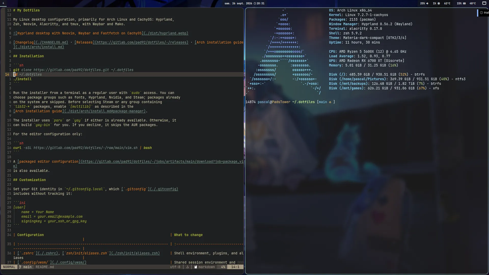

# My Dotfiles

Linux desktop configuration for Arch Linux and CachyOS, built around Hyprland,
Zsh, Neovim, Alacritty, tmux, Waybar, and Mako.



[Changelog](./CHANGELOG.md) · [Releases](https://gitlab.com/pad92/dotfiles/-/releases) · [Arch installation guide](./dist/arch/install.md)

## Install

```sh
git clone https://gitlab.com/pad92/dotfiles.git ~/.dotfiles
cd ~/.dotfiles
./install
```

Install `ansible-playbook` first, then run `./install` as a regular user with
`sudo` access. The playbook supports Arch Linux/CachyOS, Debian/Ubuntu, and
Fedora. It installs packages and deploys the configuration to your home.

Preview packages with `./install --check`, or dotfiles with
`./install --check --tags dotfiles`. Arguments pass through to
`ansible-playbook`, including `--ask-become-pass` and `-e`.

Package selection uses OS defaults and detected GPUs. Set `packages_host_groups`
in `ansible/host_vars/localhost.yml` for each hostname, or pass
`-e packages_group_selection=...` for one run. Automatic GPU selection requires
all controllers to be identified. Package variables load by OS family, then
use the first matching exact-version, major-version, or distribution override.

On Arch, Ansible configures pacman, enables standard `multilib`, and runs
`pacman -Syu` when that repository is newly enabled. Otherwise, a full upgrade
requires `-e packages_upgrade_system=true`. Missing AUR packages use `yay`,
which Ansible can build as the regular user. Choose `packages_aur_action=ask`
to confirm AUR work or `skip` to leave it out. Native makepkg builds disable
debug packages and may not run on a different CPU.

Installation is additive. Use `./install -e packages_action=reconcile` to
preview and confirm removals of packages recorded as managed by this installer.
Pre-existing packages remain unmanaged. See the [Ansible guide](./ansible/README.md)
for configuration, package ownership, and system settings.

## Ansible tasks

Use `./install --tags <tag>`. The supported-distribution check always runs.

| Tags                                       | Action                                                                                                    |
| ------------------------------------------ | --------------------------------------------------------------------------------------------------------- |
| `packages`                                 | Run package selection, installation, and reconciliation tasks.                                            |
| `packages_select`                          | Select package groups.                                                                                    |
| `packages_install`, `packages_reconcile`   | Configure repositories and install packages; the latter also runs reconciliation.                         |
| `pacman`, `pacman_config`                  | Configure `/etc/pacman.conf`.                                                                             |
| `yay`                                      | Configure pacman and run the AUR flow; selected official packages are not installed by this tag.          |
| `system`                                   | Run system configuration.                                                                                 |
| `ssh_client_hardening`, `kernel_hardening` | Configure SSH client defaults or desktop sysctls.                                                         |
| `gpu_modules`                              | Select GPU groups and configure NVIDIA/i915 kernel modules.                                               |
| `makepkg`, `makepkg_config`                | Configure native Arch builds.                                                                             |
| `amd_cpu_performance`                      | Apply supported AMD CPU settings.                                                                         |
| `gaming`                                   | Check dependencies and configure services for the selected Steam group.                                   |
| `dotfiles`                                 | Run the full dotfiles role.                                                                               |
| `dotfiles_submodules`, `dotfiles_deploy`   | Initialize submodules or deploy configuration.                                                            |
| `dotfiles_runtime`, `vim`                  | Check Vim and update plugins when `dotfiles_update_vim_plugins=true`.                                     |
| `systemd`                                  | Deploy user units, aliases, masks, and activation links; enable and start the configured graphical units. |
| `hyprlock_carousel`                        | Render the lock-screen carousel helper.                                                                   |

Configuration changes notify their handlers. Active audio services reload when
supported, otherwise restart. Changed unit definitions and drop-ins restart
only the affected active units after `daemon-reload`; changes to symbolic links
only reload the manager. Mako and Waybar reload automatically; their internal
handler tags are not standalone commands.

The default graphical units include `hypridle.service`. Run
`./install --tags systemd` to deploy user units and enable the configured list
in `dotfiles_systemd_graphical_units`. Hypridle requires `WAYLAND_DISPLAY` in
the user systemd environment to start.

## Gaming and AMD CPUs

Select `21_steam`, then run `./install --tags packages,gaming --ask-become-pass`.
The group installs `ananicy-cpp` and `power-profiles-daemon` instead of GameMode.
Ansible enables both services and stops configuration if another known CPU
power manager is active or enabled. Once this check passes, it removes any
systemd mask from `power-profiles-daemon.service` before enabling it.
CachyOS adds its Ananicy rules, Proton,
and `cachyos-settings`, which provides `game-performance`; these packages are
not selected on plain Arch. `steam-optimize` also works without
`game-performance` and sets shader-cache limits for AMD and NVIDIA.

The `amd_cpu_performance` tag uses CPU facts and kernel controls. It applies
`balance_performance` EPP through the `powersave` governor only when AMD P-State
is active and no known power manager is active or enabled. X3D CCD mode is
opt-in. These CPU settings last until reboot; a failed EPP update restores the
original governor and preference. See [AMD options](./ansible/README.md#amd-cpu-performance)
and [gaming setup](./ansible/README.md#gaming) for overrides and dependencies.

## Customize

Set Git identity in the untracked `~/.gitconfig.local`; the managed [`.gitconfig`](./ansible/roles/dotfiles/files/home/.gitconfig)
includes it.

| Configuration      | Location                                                                                                                               |
| :----------------- | :------------------------------------------------------------------------------------------------------------------------------------- |
| Shell and login    | [Zsh files](./ansible/roles/dotfiles/files/home/zsh/) and [`.zshrc`](./ansible/roles/dotfiles/templates/home/.zshrc.j2)                |
| Hyprland           | [`.config/hypr/`](./ansible/roles/dotfiles/files/home/.config/hypr/)                                                                   |
| Waybar             | [`.config/waybar/`](./ansible/roles/dotfiles/files/home/.config/waybar/)                                                               |
| Terminal and tmux  | [Alacritty](./ansible/roles/dotfiles/files/home/.config/alacritty/) and [`.tmux.conf`](./ansible/roles/dotfiles/files/home/.tmux.conf) |
| Editors            | [Neovim](./ansible/roles/dotfiles/files/home/.config/nvim/) and [Vim](./ansible/roles/dotfiles/files/home/.vimrc)                      |
| Wallpaper settings | [AWWW configuration sample](./ansible/roles/dotfiles/files/home/.config/awww/awww.conf-sample)                                         |

Host-aware files are rendered from `ansible/roles/dotfiles/templates/`. Static
files are copied from `ansible/roles/dotfiles/files/`. Conflicting managed paths are backed up before replacement. Unit symlinks
are preserved as links; deployment stops if a regular file or directory occupies
one of their destinations.

Use `make ansible-backup-ls` to list backups created for Ansible-managed
dotfiles, or `make ansible-backup-rm` to review and remove them after a
confirmation prompt. Both targets use `$HOME` by default; set
`ANSIBLE_BACKUP_ROOT=/path` on the `make` command line to select another root.

## Shell and editors

Zsh uses Oh My Zsh, autosuggestions, syntax highlighting, and custom aliases and
functions in [`zsh/`](./ansible/roles/dotfiles/files/home/zsh/). Notable helpers
include `arch_update`, `clean_arch`, `extract`, `mtail`, and GPG encrypt/decrypt
functions. The Neovim setup uses Lua, lazy.nvim, Telescope, Treesitter, Mason,
and native LSP; it requires Neovim 0.12+. The Vim setup uses Vundle.

The `mtail` function follows current and future log files across rotation. Quote
globs to include files created later:

```zsh
mtail '*.log' '/var/log/app/*.log'
```

## Desktop

The Hyprland configuration uses Lua and requires Hyprland 0.55+. See the
[session guide](./dist/arch/install.md#gnome-keyring-pam-setup) for TTY startup,
GNOME Keyring PAM, UWSM, and systemd session setup.

| Shortcut                            | Action                                           |
| :---------------------------------- | :----------------------------------------------- |
| `SUPER + Return`                    | Terminal                                         |
| `SUPER + E / C / W`                 | File manager / editor / browser                  |
| `SUPER + [0-9]`                     | Switch workspace; add `Shift` to move the window |
| `SUPER + Arrows` or Vim keys        | Change focus; add `Shift` to move the window     |
| `SUPER + F` / `SUPER + ALT + Space` | Fullscreen / floating                            |
| `SUPER + L` / `SUPER + Delete`      | Lock / logout menu                               |
| `Print` / `SUPER + P`               | Screenshot                                       |

`awww.sh` selects wallpapers per monitor from local files or configured NFS/CIFS
mounts. Copy its sample to `~/.config/awww/awww.conf` to configure sources.
Renders are cached under a managed directory with a 2 GiB default quota;
references are preserved. ImageMagick is required. `awww.service` starts with
Hyprland and `awww_random.timer` changes wallpapers every 30 minutes.

Hyprlock displays time, battery, and media information. Its carousel option
uses configured AWWW sources. See the [Hyprlock templates and helpers](./ansible/roles/dotfiles/templates/home/.config/hypr/hyprlock.conf.j2)
for details. The LACT profile is deployed to `~/.config/lact/config.yaml`, not
`/etc/lact/config.yaml`. Verify the GPU identifier and review the fan curves
before relying on it.

## Scripts

The playbook deploys [`~/.bin/`](./ansible/roles/dotfiles/files/home/.bin/) and
adds it to `PATH` in Zsh.

| Script                                                                                                                           | Purpose                                          |
| :------------------------------------------------------------------------------------------------------------------------------- | :----------------------------------------------- |
| [`steam-optimize`](./ansible/roles/dotfiles/files/home/.bin/steam-optimize)                                                      | Configure per-game Vulkan and Gamescope options. |
| [`backup.sh`](./ansible/roles/dotfiles/files/home/.bin/backup.sh)                                                                | Back up files with rsync over SSH.               |
| [`awww.sh`](./ansible/roles/dotfiles/files/home/.bin/awww.sh)                                                                    | Select and render wallpapers.                    |
| [`razer_dpi.py`](./ansible/roles/dotfiles/files/home/.bin/razer_dpi.py)                                                          | Configure Razer mouse DPI.                       |
| [`hypr-screenshot.sh`](./ansible/roles/dotfiles/files/home/.bin/hypr-screenshot.sh)                                              | Capture the desktop showcase.                    |
| [`comcut`](./ansible/roles/dotfiles/files/home/.bin/comcut), [`comskip.sh`](./ansible/roles/dotfiles/files/home/.bin/comskip.sh) | Detect and remove commercial breaks.             |
| [`diff-cmd`](./ansible/roles/dotfiles/files/home/.bin/diff-cmd)                                                                  | Compare command output for two arguments.        |
| [`vscodium_ext.sh`](./ansible/roles/dotfiles/files/home/.bin/vscodium_ext.sh)                                                    | Install VSCodium extensions.                     |

Package cleanup is opt-in. Pass `--clean-packages` to `backup.sh` to run
`yay -Sc` on Arch or `apt autoremove --purge` on Debian.

To install the Vim configuration, run [`scripts/vim.sh`](./scripts/vim.sh).
GitLab CI also builds downloadable [Vim](https://gitlab.com/pad92/dotfiles/-/jobs/artifacts/main/download?job=package_vim)
and [Neovim](https://gitlab.com/pad92/dotfiles/-/jobs/artifacts/main/download?job=package_nvim)
configuration archives.

## CI and releases

GitHub, GitLab, and Gitea use shared scripts in [`scripts/ci/`](./scripts/ci/).
See the [GitHub workflow documentation](./.github/workflows/README.md) and
[GitLab CI documentation](./.gitlab/README.md). Tags matching `v*` publish a
release using the matching changelog section.

_Maintained by [pad](https://gitlab.com/pad92) since 2015._
