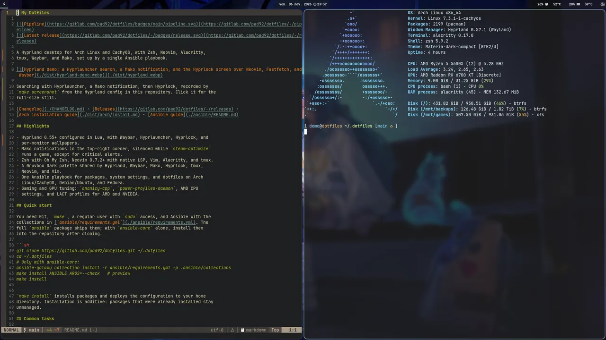

# My Dotfiles

[](https://gitlab.com/pad92/dotfiles/-/pipelines)
[](https://gitlab.com/pad92/dotfiles/-/releases)

A Hyprland desktop for Arch Linux and CachyOS, with Zsh, Neovim, Alacritty,
tmux, Waybar, and Mako, set up by a single Ansible playbook.

[](./dist/hyprland.webp)

Searching with Hyprlauncher, a Mako notification, then Hyprlock, recorded by
`make screenshot` from the Hyprland config in this repository. Click it for the
full-size still.

[Changelog](./CHANGELOG.md) · [Releases](https://gitlab.com/pad92/dotfiles/-/releases) ·
[Arch installation guide](./dist/arch/install.md) · [Ansible guide](./ansible/README.md)

## Highlights

- Hyprland 0.55+ configured in Lua, with Waybar, Hyprlauncher, Hyprlock, and
  per-monitor wallpapers.
- Mako notifications in the top-right corner, silenced while `steam-optimize`
  runs a game, except for critical alerts.
- Zsh with Oh My Zsh, Neovim 0.7.2+ with native LSP, Vim, Alacritty, and tmux.
- A Gruvbox Dark palette shared by Hyprland, Waybar, Mako, Hyprlock, tmux,
  Neovim, and Vim.
- One Ansible playbook for packages, system settings, and dotfiles on Arch
  Linux/CachyOS, Debian/Ubuntu, and Fedora.
- Gaming and GPU tuning: `ananicy-cpp`, `power-profiles-daemon`, AMD CPU
  settings, and LACT profiles for AMD and NVIDIA.

## Quick start

You need Git, `make`, a regular user with `sudo` access, and Ansible with the
collections in [`ansible/requirements.yml`](./ansible/requirements.yml). The
full `ansible` package ships them; with `ansible-core` alone, install them
into the repository after cloning.

```sh
git clone https://gitlab.com/pad92/dotfiles.git ~/.dotfiles
cd ~/.dotfiles
# Only with ansible-core:
ansible-galaxy collection install -r ansible/requirements.yml -p .ansible/collections
make install ANSIBLE_ARGS=--check   # preview
make install
```

`make install` installs packages and deploys the configuration to your home
directory. Installation is additive: packages that were already installed stay
unmanaged.

## Common tasks

Options in `ANSIBLE_ARGS` go straight to `ansible-playbook`.

| Goal                                 | Command                                                                |
| :----------------------------------- | :--------------------------------------------------------------------- |
| Preview a full run                   | `make install ANSIBLE_ARGS=--check`                                    |
| Print only the package plan          | `make install ANSIBLE_ARGS="-e packages_action=plan"`                  |
| Deploy the dotfiles only             | `make install ANSIBLE_ARGS="--tags dotfiles_deploy"`                   |
| Preview the dotfiles only            | `make install ANSIBLE_ARGS="--check --tags dotfiles"`                  |
| Remove packages this installer added | `make install ANSIBLE_ARGS="-e packages_action=reconcile"`             |
| Set up the Steam group               | `make install ANSIBLE_ARGS="--tags packages,gaming --ask-become-pass"` |
| Upgrade the whole system on Arch     | `make install ANSIBLE_ARGS="-e packages_upgrade_system=true"`          |
| List or remove dotfile backups       | `make ansible-backup-ls` / `make ansible-backup-rm`                    |

Reconciliation previews the removals and asks for confirmation. The backup
targets use `$HOME`; set `ANSIBLE_BACKUP_ROOT=/path` to select another root.

<details>
<summary>Package selection and Arch specifics</summary>

Package groups come from OS defaults and detected GPUs. Set
`packages_host_groups` per hostname in `ansible/host_vars/localhost.yml`, or
pass `-e packages_group_selection=...` for one run. Automatic GPU selection
requires every controller to be identified. Package variables load by OS
family, then use the first matching exact-version, major-version, or
distribution override.

On Arch, Ansible configures pacman, enables the standard `multilib` repository,
and runs `pacman -Syu` when it enables that repository. Missing AUR packages
use `yay`, which Ansible can build as the regular user. Set
`packages_aur_action=ask` to confirm AUR work or `skip` to leave it out. Native
makepkg builds disable debug packages and may not run on a different CPU.

</details>

## Ansible tags

Run a subset with `make install ANSIBLE_ARGS="--tags <tag>"`. The
supported-distribution check always runs. The [Ansible guide](./ansible/README.md)
covers variables, package ownership, and system settings.

| Tags                                       | Action                                                                        |
| :----------------------------------------- | :---------------------------------------------------------------------------- |
| `packages`                                 | Select, install, and reconcile packages.                                      |
| `packages_select`                          | Select package groups.                                                        |
| `packages_install`, `packages_reconcile`   | Install packages; the latter also runs reconciliation.                        |
| `pacman`, `pacman_config`                  | Configure `/etc/pacman.conf`.                                                 |
| `yay`                                      | Configure pacman and run the AUR flow only.                                   |
| `system`                                   | Run the whole system role.                                                    |
| `package_services`                         | Enable the services of the selected package groups.                           |
| `ssh_client_hardening`, `kernel_hardening` | Configure SSH client defaults or desktop sysctls.                             |
| `dns`                                      | Make systemd-resolved the only resolver, for the host and Docker.             |
| `gpu_modules`                              | Select GPU groups and configure NVIDIA/i915 kernel modules.                   |
| `makepkg`, `makepkg_config`                | Configure native Arch builds.                                                 |
| `amd_cpu_performance`                      | Apply supported AMD CPU settings.                                             |
| `gaming`                                   | Check dependencies and configure services for the Steam group.                |
| `lact`                                     | Manage `/etc/lact/config.yaml`.                                               |
| `dotfiles`                                 | Run the whole dotfiles role.                                                  |
| `dotfiles_submodules`, `dotfiles_deploy`   | Initialize submodules or deploy the configuration.                            |
| `dotfiles_claude`                          | Add the Claude Code status line when `claude` is installed.                   |
| `dotfiles_runtime`, `vim`                  | Check Vim; update plugins with `dotfiles_update_vim_plugins=true`.            |
| `systemd`                                  | Deploy user units and enable the units in `dotfiles_systemd_graphical_units`. |
| `hyprlock_carousel`                        | Render the lock-screen carousel helper.                                       |

Changed files notify their handlers: Mako and Waybar reload, active audio
services reload or restart, and active user units whose definitions changed
restart after `daemon-reload`. Hypridle needs `WAYLAND_DISPLAY` in the user
systemd environment to start.

## Desktop

The Hyprland configuration is written in Lua. See the
[session guide](./dist/arch/install.md#gnome-keyring-pam-setup) for TTY
startup, GNOME Keyring PAM, UWSM, and the systemd session.

| Shortcut                            | Action                                           |
| :---------------------------------- | :----------------------------------------------- |
| `SUPER + Return`                    | Terminal                                         |
| `SUPER + E / C / W`                 | File manager / editor / browser                  |
| `SUPER + D`                         | Application menu                                 |
| `SUPER + [0-9]`                     | Switch workspace; add `Shift` to move the window |
| `SUPER + Arrows` or Vim keys        | Change focus; add `Shift` to move the window     |
| `SUPER + F` / `SUPER + ALT + Space` | Fullscreen / floating                            |
| `SUPER + L` / `SUPER + Delete`      | Lock / logout menu                               |
| `SUPER + SHIFT + V`                 | Clipboard history                                |
| `Print` / `SUPER + P`               | Screenshot                                       |
| `SUPER + N`                         | Dismiss notifications; `Shift` restores the last |

Mako shows up to five notifications in the top-right corner, newest first, and
draws them above fullscreen windows. `steam-optimize` turns on do-not-disturb
during games; critical alerts still appear and stay until dismissed.

`awww.sh` picks wallpapers per monitor from local files or NFS/CIFS mounts.
Copy its sample to `~/.config/awww/awww.conf` to configure sources. Renders are
cached with a 2 GiB default quota, and `awww_random.timer` changes wallpapers
every 30 minutes. ImageMagick is required.

Hyprlock shows the time, battery, and current media. Its carousel option uses
the AWWW sources; see the
[Hyprlock template](./ansible/roles/dotfiles/templates/home/.config/hypr/hyprlock.conf.j2).

## Gaming and GPUs

Select the `21_steam` group, then run
`make install ANSIBLE_ARGS="--tags packages,gaming --ask-become-pass"`. The
group installs `ananicy-cpp` and `power-profiles-daemon` instead of GameMode.
Ansible enables both services and stops if another known CPU power manager is
active or enabled. On CachyOS it also adds the CachyOS Ananicy rules, Proton,
and `cachyos-settings`, which provides `game-performance`. `steam-optimize`
works without `game-performance` and sets shader-cache limits for AMD and
NVIDIA.

The `amd_cpu_performance` tag applies `balance_performance` EPP through the
`powersave` governor, only when AMD P-State is active and no known power
manager is running. X3D CCD mode is opt-in. A failed EPP update restores the
original governor and preference.

The `lact` tag manages `/etc/lact/config.yaml` with the GPU identifiers
reported by the running LACT daemon. It keeps existing profiles and fan curves,
backs up changes, and restarts `lactd` when needed. It adds `Auto`, `Adaptive`,
and `PreferMaximumPerformance` profiles, named after LACT's PowerMizer modes,
for detected AMD and NVIDIA GPUs. Intel GPU settings are left unchanged.

See [AMD options](./ansible/README.md#amd-cpu-performance) and
[gaming setup](./ansible/README.md#gaming) for overrides and dependencies.

## Customize

Set your Git identity in the untracked `~/.gitconfig.local`; the managed
[`.gitconfig`](./ansible/roles/dotfiles/files/home/.gitconfig) includes it.

| Configuration      | Location                                                                                                                               |
| :----------------- | :------------------------------------------------------------------------------------------------------------------------------------- |
| Shell and login    | [Zsh files](./ansible/roles/dotfiles/files/home/zsh/) and [`.zshrc`](./ansible/roles/dotfiles/templates/home/.zshrc.j2)                |
| Hyprland           | [`.config/hypr/`](./ansible/roles/dotfiles/files/home/.config/hypr/)                                                                   |
| Waybar             | [`.config/waybar/`](./ansible/roles/dotfiles/files/home/.config/waybar/)                                                               |
| Notifications      | [`.config/mako/config`](./ansible/roles/dotfiles/files/home/.config/mako/config)                                                       |
| Terminal and tmux  | [Alacritty](./ansible/roles/dotfiles/files/home/.config/alacritty/) and [`.tmux.conf`](./ansible/roles/dotfiles/files/home/.tmux.conf) |
| Editors            | [Neovim](./ansible/roles/dotfiles/files/home/.config/nvim/) and [Vim](./ansible/roles/dotfiles/files/home/.vimrc)                      |
| Wallpaper settings | [AWWW configuration sample](./ansible/roles/dotfiles/files/home/.config/awww/awww.conf-sample)                                         |

Static files are copied from `ansible/roles/dotfiles/files/` and host-aware
files are rendered from `ansible/roles/dotfiles/templates/`. Managed paths that
conflict are backed up before replacement. Unit symlinks stay links; deployment
stops if a regular file or directory occupies one of their destinations.

## Shell and editors

Zsh uses Oh My Zsh, autosuggestions, syntax highlighting, and the aliases and
functions in [`zsh/`](./ansible/roles/dotfiles/files/home/zsh/), including
`arch_update`, `clean_arch`, `extract`, `mtail`, and GPG helpers. `mtail`
follows log files across rotation; quote globs to include files created later:

```zsh
mtail '*.log' '/var/log/app/*.log'
```

Neovim uses Lua, Telescope, Treesitter, Mason, and native LSP. Neovim 0.8+
loads plugins with lazy.nvim; Neovim 0.7.2 uses a compatibility loader with
older plugin releases. Vim uses Vundle.

GitLab publishes standalone configuration archives for both editors. Back up
your current configuration first: extraction replaces files with the same
names.

<details>
<summary>Install the Neovim configuration on its own</summary>

The archive installs `~/.config/nvim`.

```sh
set -eu
archive=$(mktemp)
trap 'rm -f -- "$archive"' EXIT
curl -fL 'https://gitlab.com/pad92/dotfiles/-/jobs/artifacts/main/raw/nvim.tar.gz?job=package_nvim' -o "$archive"
tar -tzf "$archive"
read -r -p 'Extract this archive into your home directory? [y/N] ' confirm
[ "$confirm" = y ] || exit 1
tar -xzf "$archive" -C "$HOME"
```

</details>

<details>
<summary>Install the Vim configuration on its own</summary>

The archive installs `~/.vim` and `~/.vimrc`. To install the plugins as well,
run [`scripts/vim.sh`](./scripts/vim.sh), which downloads the archive and runs
Vundle.

```sh
set -eu
archive=$(mktemp)
trap 'rm -f -- "$archive"' EXIT
curl -fL 'https://gitlab.com/pad92/dotfiles/-/jobs/artifacts/main/raw/vim.tar.gz?job=package_vim' -o "$archive"
tar -tzf "$archive"
read -r -p 'Extract this archive into your home directory? [y/N] ' confirm
[ "$confirm" = y ] || exit 1
tar -xzf "$archive" -C "$HOME"
```

</details>

## Scripts

The playbook deploys [`~/.bin/`](./ansible/roles/dotfiles/files/home/.bin/) and
Zsh adds it to `PATH`.

| Script                                                                                                                           | Purpose                                          |
| :------------------------------------------------------------------------------------------------------------------------------- | :----------------------------------------------- |
| [`steam-optimize`](./ansible/roles/dotfiles/files/home/.bin/steam-optimize)                                                      | Configure per-game Vulkan and Gamescope options. |
| [`backup.sh`](./ansible/roles/dotfiles/files/home/.bin/backup.sh)                                                                | Back up files with rsync over SSH.               |
| [`awww.sh`](./ansible/roles/dotfiles/files/home/.bin/awww.sh)                                                                    | Select and render wallpapers.                    |
| [`razer_dpi.py`](./ansible/roles/dotfiles/files/home/.bin/razer_dpi.py)                                                          | Configure Razer mouse DPI.                       |
| [`hypr-screenshot.sh`](./ansible/roles/dotfiles/files/home/.bin/hypr-screenshot.sh)                                              | Record the desktop still and animated demo.      |
| [`comcut`](./ansible/roles/dotfiles/files/home/.bin/comcut), [`comskip.sh`](./ansible/roles/dotfiles/files/home/.bin/comskip.sh) | Detect and remove commercial breaks.             |
| [`diff-cmd`](./ansible/roles/dotfiles/files/home/.bin/diff-cmd)                                                                  | Compare command output for two arguments.        |
| [`vscodium_ext.sh`](./ansible/roles/dotfiles/files/home/.bin/vscodium_ext.sh)                                                    | Install VSCodium extensions.                     |

`backup.sh` only cleans package caches when you pass `--clean-packages`: it
then runs `yay -Sc` on Arch or `apt autoremove --purge` on Debian.

## Development

| Command             | What it does                                                                |
| :------------------ | :-------------------------------------------------------------------------- |
| `make test`         | Run the Python and shell test suites. Set `JOBS=N` to limit parallelism.    |
| `make coverage`     | Run the Python tests under coverage.py and enforce the `.coveragerc` floor. |
| `make lint-ansible` | Run ansible-lint, yamllint, and the playbook syntax check.                  |
| `make screenshot`   | Render the desktop showcase at the top of this page (`RES`, `SETTLE`, ...). |

GitLab, GitHub, and Gitea share the scripts in [`scripts/ci/`](./scripts/ci/);
see the [GitHub workflows](./.github/workflows/README.md) and
[GitLab CI](./.gitlab/README.md) documentation. Pushing a `v*` tag publishes a
release with the matching [changelog](./CHANGELOG.md) section. The repository
is mirrored on [GitLab](https://gitlab.com/pad92/dotfiles),
[GitHub](https://github.com/pad92/dotfiles), and
[Codeberg](https://codeberg.org/pad7/.dotfiles).

_Maintained by [pad](https://gitlab.com/pad92)🐐 since 2015._
